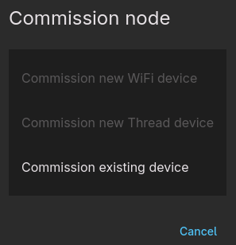

Because ESPHome already provides Wi-Fi or Thread credentials, commissioning works differently from most Matter devices.

After flashing the device, a commission code is generated and shown (SetupQRCode). Copy this code or click the link and scan the QR-code.

```
[C][matter]: Matter:
[C][matter]:   SetupQRCode: MT:Y.K904QI14-O992WI00
[C][matter]:   QR URL: https://project-chip.github.io/connectedhomeip/qrcode.html?data=MT:Y.K904QI14-O992WI00
[C][matter]:   Manual pairing code: 3255-201-4321
[C][matter]:   Commissioning window: open
[C][matter]:   Fabrics: none
```

## Setup codes in Home Assistant

Setup codes are printed at CONFIG log level during startup. To read them after
boot through the [native ESPHome API](https://esphome.io/components/api/), add a
Matter text sensor:

```yaml
text_sensor:
  - platform: matter
    qr_code: # QR code formatted as MT:xxxxxxxxxxxxxxxxxxx
      name: "Matter QR-code string"
    manual_pairing_code: # Pairing code formatted as 0000-000-0000
      name: "Matter manual pairing code"
    fabric_1:
      compressed_fabric_id:
        name: "Matter fabric 1 compressed ID"
      fabric_id:
        name: "Matter fabric 1 ID"
      label:
        name: "Matter fabric 1 label"
      node_id:
        name: "Matter fabric 1 node ID"
      vendor_id:
        name: "Matter fabric 1 vendor ID"
```

Both accept the standard [text sensor options](https://esphome.io/components/text_sensor/)
and default to the diagnostic entity category. Values remain available when
Home Assistant reconnects. A code value does not indicate whether the
commissioning window is open; see [Persistence](#persistence) below.

Fabric slots `fabric_1` through `fabric_255` can each expose a `compressed_fabric_id`, `fabric_id`,
`label`, `node_id`, and `vendor_id` text sensor and are very useful for debugging commissioning issues.
Slots remain unknown while they have never contained a fabric. When an existing fabric is removed, its
slot is cleared. However, due to a limitation in the `text_sensor`, the values can't be set back to
unknown and becomes an empty string until after a restart.

## Setup codes from a factory partition

By default the setup code is generated on the device and stored in the `nvs`
partition, passcode included. To give each device a code made off the device
instead, such as one printed on a label, put the commissioning data in a
separate NVS partition and name it:

```yaml
esp32:
  partitions: partitions.csv # with e.g. "fctry, data, nvs, 0x1A000, 0x6000"

matter:
  factory_partition: fctry
```

Make the partition image with
[esp-matter-mfg-tool](https://pypi.org/project/esp-matter-mfg-tool/), which
stores the discriminator, salt, iteration count and verifier but not the
passcode, and write it once over serial:

```bash
esp-matter-mfg-tool -v 0xFFF1 -p 0x8000 -s 0x6000 --outdir out
esptool.py write_flash 0x1A000 out/<vid>_<pid>/<uuid>/<uuid>-partition.bin
```

OTA updates and the Matter factory reset leave the partition alone, so the code
stays the same for the life of the device. Without the passcode on the device,
no QR code or manual pairing code is logged or published to the text sensors.
If the partition is empty, a code is generated and stored there as without the
option. The device never writes to the partition otherwise, so the device name
is not advertised in the `DN` record.

## Matter reset button

To remove all Matter fabrics and restart for initial commissioning:

```yaml
button:
  - platform: template
    name: "Matter Factory Reset"
    on_press:
      - matter.factory_reset:
```

This keeps the stored setup code, ESPHome preferences, and Wi-Fi or Thread
credentials. Pair the device with its Matter controllers again after the reset.

# Commissioners

### matterjs-server / Home Assistant

To accept the dev DAC that esphome-matter uses, matterjs-server should be started with the `--enable-test-net-dcl` argument set to `true`;

`matterjs-server --enable-test-net-dcl=true`

Or the `ENABLE_TEST_NET_DCL` environment variable should be set to `true`.

For the Home Assistant Matter Server app, enable **Enable test-net DCL usage**
under **Settings → Apps → Matter Server → Configuration**. Save and restart
the Matter Server app to apply the setting.

When commissioning, use the "Commission existing device" option;



### python-matter-server

Accepts the dev DAC without any problems. But python-matter-server is discontinued and replaced by matterjs-server.

##### IKEA Dirigera

In the IKEA Home smart app, add the device by opening the QR url and scanning the code.

The IKEA system doesn't like it when a device has multiple endpoints. With the example config where a button, temperature sensor and light are configured, only the temperature sensor is shown in the app. If only the light endpoint is configured, it is detected correctly as a light.

# Persistence

The SetupQRCode is stored in flash and survives OTA updates. For a device with
no stored fabrics, restarting reopens the initial commissioning window for
15 minutes. Once the device has a fabric, a restart does not reopen that
window: use the controller's sharing flow and its temporary code to add another
controller. The original code can be used again after a Matter factory reset.

The fabric data is also stored on flash (nvs partition) and also survives ota updates. The fabric itself is independent of the hardware layer (wifi or thread). This means that it's even possible to commission a device over wifi and later substitute the wifi component with openthread (as long as the hardware supports both) and you don't need to re-commission!

Keep the NVS partition and endpoint IDs stable across updates. For discovery
problems after a Thread reboot, see [Thread debugging](dev/thread-debugging.md#commissioned-devices-after-reboot).

# Multiple fabrics

Up to 5 fabrics are supported by default, but if needed, this can be increased with the `CONFIG_MAX_FABRICS` sdkconfig option:

```yaml
esp32:
  framework:
    type: esp-idf
    sdkconfig_options:
      CONFIG_MAX_FABRICS: # Set to anything from 5 to 255
```
